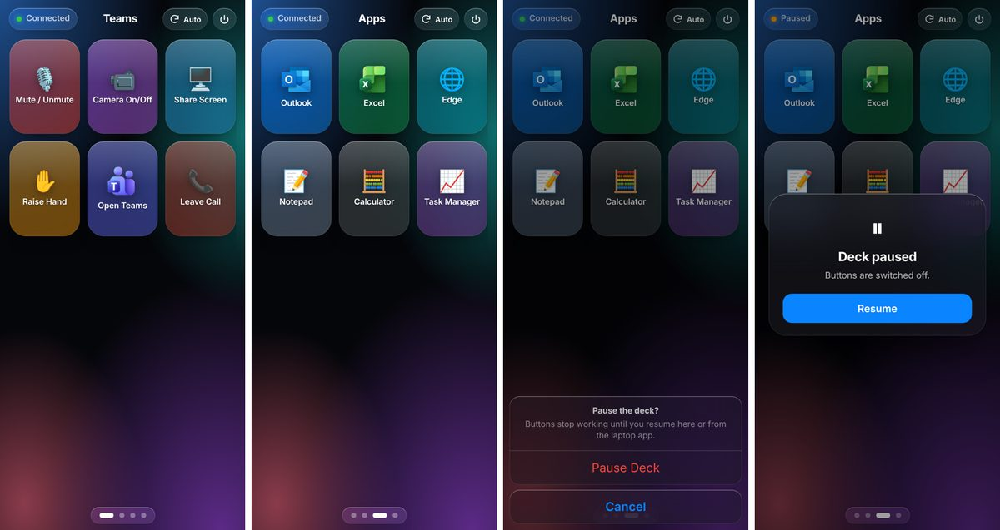
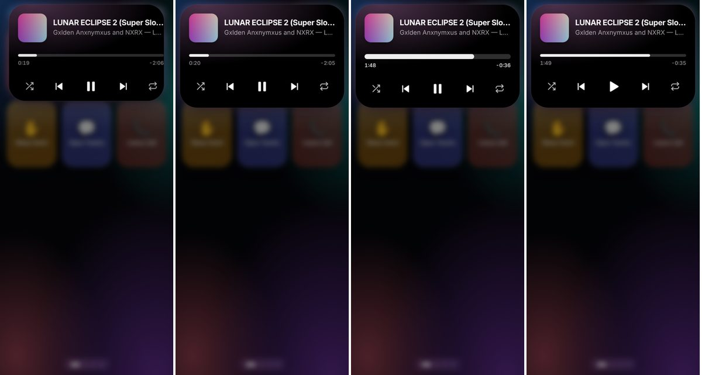
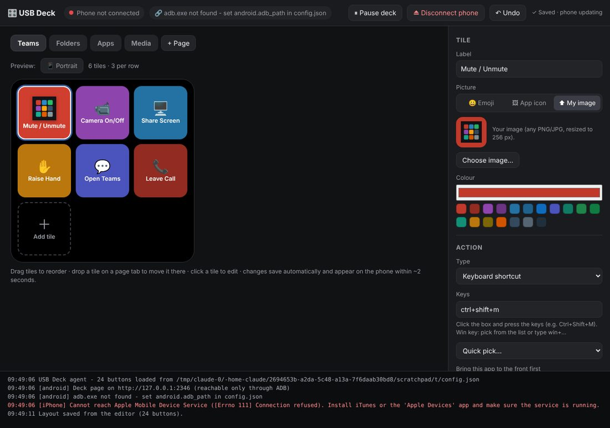
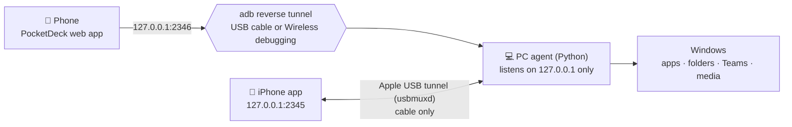

<h1 align="center">PocketDeck</h1>

<p align="center"><b>Turn the phone in your pocket into a Stream&nbsp;Deck for your Windows PC.</b><br>
Big touch buttons that open your apps and folders, run your Teams calls and control your music,<br>over a USB cable or a private Wi-Fi link. No extra hardware, no cloud, no open network port.</p>

<p align="center">
  
  
  
  
  
</p>

<p align="center"></p>

---

## Why

A Stream Deck costs money and takes desk space. Most of us already have an old phone or a spare tablet. PocketDeck runs a small agent on the PC and shows its buttons on the phone. When you tap a tile, the **PC** does the work.

## Features

**On the phone**
- 🧊 **Glass, iPhone-style deck.** Frosted tiles with the **real app icons** from your PC. Tiles respond the instant you touch them, and haptics fire when an action runs.
- 👆 **Taps and swipes that don't collide.** A tile fires when you lift your finger, so swiping between pages never triggers one.
- 📐 **Fixed tile size with auto pages.** Each screen fits as many rows as it can in portrait or landscape. Extra tiles continue on a new page you swipe to.
- 🎵 **Now-playing notch.** A Dynamic-Island-style pill shows the album art and live bars. Tap it for a full player with a draggable scrubber, shuffle, previous, play/pause, next and repeat.
- 🪟 **"Already open?"** If Outlook, SQL Developer or YouTube Music is already running, the phone asks whether to switch to it or open a new window.
- 🔄 Rotation lock (auto / portrait / landscape), and ⏸ pause / resume from the phone or the PC.

**On the PC**
- 🖱️ **Visual editor.** Drag tiles to reorder them and drop them on a page tab to move them. Set the label, colour and picture (emoji, real app icon or your own image), test any action, and undo. The phone updates in about 2 seconds.
- 🚀 **Actions:** open apps, folders, files and URLs (**maximised and in front**), keyboard shortcuts, **Teams** (mute, camera, share, raise hand, leave), **media control** through Windows' own media session, any command line, and multi-step actions.
- 🧠 **Smart app detection:** new Outlook (`olk.exe`), Store apps (Claude, Teams), Chrome/Edge web apps (YouTube Music) and launcher-style apps (SQL Developer's `sqldeveloper.exe` → `sqldeveloper64W.exe`).

<p align="center">
  <br>
  
</p>

## How it works



The agent **only listens on the PC's loopback address**, so nothing on your Wi-Fi or office network can reach it. The phone gets in through Android's debugging tunnel (`adb reverse`), which needs a phone you approved once. On iPhone, Apple's USB multiplexer (the same channel iTunes uses) is the only way in. The layout editor also needs a secret token that only the desktop shortcut has, so the phone can press buttons but can't change them.

## Quick start (Android)

**On the PC** (about 3 minutes)
1. Download the latest release zip, or clone this repo.
2. Run `installer\Install PocketDeck.bat`. It installs Python if needed, downloads Google's platform-tools (`adb`), installs the music add-on and creates a desktop shortcut.

**On the phone** (one time)
1. Turn on **Developer options**: Settings › About phone › Software information › tap *Build number* 7 times.
2. Turn on **USB debugging**, plug into the PC and tap **Allow**.
3. In Chrome, open **`http://127.0.0.1:2346`**, then ⋮ › **Add to Home screen** › **Install**.

**Optional: no cable.** Turn on *Wireless debugging* and pair once with `adb pair <ip:port> <code>`. At home the PC finds the phone by itself. On networks that block discovery (most offices), type the phone's `IP:port` into the **Connect** box in the editor.

Full guide: [`installer/SETUP-ANDROID.txt`](installer/SETUP-ANDROID.txt) · Reference: [`docs/GUIDE.md`](docs/GUIDE.md)

## iPhone (beta)

There is a native SwiftUI app in [`ios/`](ios). It is built in the cloud by GitHub Actions, so **no Mac is needed**.

1. Install iTunes + iCloud from apple.com (for *Apple Mobile Device Service*).
2. In your fork, go to **Actions › Build USB Deck (unsigned IPA) › Run workflow** and download `USBDeck.ipa`.
3. Install it with [Sideloadly](https://sideloadly.io) using your Apple ID. Then on the iPhone go to Settings › General › VPN & Device Management › **Trust**. With a free Apple ID, re-sign every 7 days.

> **Status:** the iPhone app is an earlier, simpler client (button grid and pages, cable only). The glass UI, app icons, now-playing notch and "already open?" prompt are Android-only for now, and the iOS build has not been compiled and tested on a device yet. Contributions welcome.

## Configuration

Everything lives in `windows/config.json`. It is created from [`config.example.json`](windows/config.example.json) on first run and normally edited in the GUI.

```jsonc
{ "id": "teams_mute", "label": "Mute / Unmute", "emoji": "🎙️", "color": "#C0392B",
  "action": { "type": "hotkey", "keys": "ctrl+shift+m", "focus": "teams", "restore_focus": true } }
```

| Action `type` | Example | Notes |
|---|---|---|
| `open` | `"target": "%USERPROFILE%\\Documents"` | Apps, folders, files, URLs, `shell:AppsFolder\…`. Options: `window` (`maximize`/`front`/`normal`) and `if_open` (`ask`/`switch`/`new`) |
| `hotkey` | `"keys": "ctrl+shift+e", "focus": "teams"` | `focus` brings that app forward first |
| `media` | `"command": "next"` | `toggle`, `next`, `prev`, `stop`, `shuffle`, `repeat` |
| `run` | `"command": "rundll32.exe user32.dll,LockWorkStation"` | Any command line |
| `multi` | `"steps": [ … ], "delay_ms": 200` | Several actions in a row |

Deck-wide: `columns`, `columns_landscape`, `rows` (omit for auto-fit), `open_window`, `if_open`.

## Project layout

```
windows/      PC agent (Python, stdlib only + optional winrt for music) and the web UI it serves
  deck_agent.py   entry point · web_deck.py  phone/editor server + adb tunnel keeper
  actions.py      what tiles do · icons.py  real app icons · media.py  now playing (SMTC)
  web/            deck.html (phone) · editor.html (PC)
ios/          SwiftUI iPhone client (XcodeGen project)
installer/    one-click Windows installer + Android setup guide
.github/      cloud build for the iPhone app
docs/         full guide and screenshots
```

## Troubleshooting

| Symptom | Fix |
|---|---|
| Phone says *Not connected* | Make sure the PC agent is running (desktop shortcut), and the cable is in or Wireless debugging is on |
| Android shows *Check USB port* | Lint or moisture in the phone's port. Clean it gently with a wooden toothpick |
| A tile flashes red | The log at the bottom of the editor says why, for example a folder that no longer exists |
| No now-playing notch | Run `py -m pip install --user winrt-runtime winrt-Windows.Media.Control winrt-Windows.Storage.Streams winrt-Windows.Foundation winrt-Windows.Foundation.Collections` |
| Work laptop | IT policy may block Python installs or USB debugging |

## Roadmap

- [ ] Bring the iPhone app up to the Android feature set (icons, notch, glass UI)
- [ ] Tray icon for the PC agent
- [ ] Per-app profiles (switch tile pages when the active window changes)
- [ ] Folders and multi-actions in the editor UI

## Contributing

Issues and pull requests are welcome. The PC agent intentionally uses only the Python standard library (plus the optional `winrt` packages for music), so it installs anywhere Python runs.

## License

[MIT](LICENSE) © 2026 Ashish Jeevanesan

<sub>PocketDeck is an independent project and is not affiliated with or endorsed by Elgato or Corsair. "Stream Deck" is a trademark of Corsair Memory, Inc.</sub>
