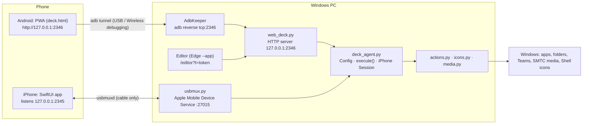

# PocketDeck: Project History & Architecture Handover

This document is the complete context for PocketDeck: how it started, every idea and decision along the way, the problems we hit and how we solved them, and a full description of the current architecture. It is written so that someone new (a contributor, or a fresh AI session) can pick the project up without the original conversation.

> **Status at the time of writing (Nov 2026):** v1.0.0 released, v1.0.1 built. Android + Windows is the primary, tested platform. The iPhone app exists but is an earlier, simpler client that has not yet been built or tested on a device.

---

## Contents

1. [Origin and goals](#1-origin-and-goals)
2. [Timeline of the work](#2-timeline-of-the-work)
3. [Key decisions and why](#3-key-decisions-and-why)
4. [Issues faced and how they were fixed](#4-issues-faced-and-how-they-were-fixed)
5. [Architecture overview](#5-architecture-overview)
6. [Component reference (PC side)](#6-component-reference-pc-side)
7. [Phone deck (web app)](#7-phone-deck-web-app)
8. [Laptop editor](#8-laptop-editor)
9. [iPhone app](#9-iphone-app)
10. [Protocols and APIs](#10-protocols-and-apis)
11. [Configuration schema](#11-configuration-schema)
12. [Security model](#12-security-model)
13. [Installer, release build and repository](#13-installer-release-build-and-repository)
14. [How it was tested](#14-how-it-was-tested)
15. [Operating it day to day](#15-operating-it-day-to-day)
16. [Known limitations and roadmap](#16-known-limitations-and-roadmap)

---

## 1. Origin and goals

**The idea.** Use an old **iPhone 6s** (and an iPad) as an Elgato-style **Stream Deck** for a **Windows** work laptop. The hard requirements were:

- **Cable only and no latency.** The deck must work over a USB cable, and must not be reachable over Wi-Fi.
- **Practical actions.** Open specific macro/work folders, open a few applications, and run Teams calls (mute/unmute, share screen).

**What we found before building.**

| Option | USB | Works on iPhone 6s (max iOS 15.8) | Notes |
|---|---|---|---|
| Elgato Stream Deck Mobile | Yes (app 2.3.1+, desktop 6.7+) | **No**: needs iOS 17+ | Free tier has 6 keys; Pro is a subscription |
| TouchOSC + TouchOSC Bridge | Yes (Bridge talks to the phone through libimobiledevice) | Yes (iOS 13+) | Sends MIDI; needs a MIDI→keystroke mapper |
| TouchOSC Mk1 | Yes | Yes (iOS 9+) | Old, unmaintained since 2021 |
| Touch Portal, Deckboard | No (Wi-Fi only) | Yes | Breaks the cable-only requirement |

Nothing met all the requirements, so we built our own. The user chose **Windows-only, iPhone first**, with folders, apps and Teams as the main use cases.

**Later goals that emerged:**
- Android support (Samsung Galaxy S23); Wi-Fi allowed as long as it stays private
- A desktop GUI to arrange tiles, with connect/disconnect controls on both sides
- Real app icons, an Apple-like glass UI and touch response, a Dynamic-Island-style music player
- "Already open?" behaviour, apps opening maximised, fixed tile size with overflow pages
- A shareable installer, a GitHub repo (name chosen: **PocketDeck**), versioned releases

---

## 2. Timeline of the work

### Day 1: iPhone design and the first build
1. **Research** (table above) → decision to build.
2. **Architecture for iPhone:** an iOS app listens on **loopback** `127.0.0.1:2345`. The PC reaches it through Apple's **USB multiplexer** (`usbmuxd`, provided on Windows by *Apple Mobile Device Service* from iTunes/Apple Devices). This is the same channel Xcode and iTunes use, so the deck is physically cable-only.
3. **Built:** SwiftUI iOS app (`ios/`), Python agent (`windows/`), and a GitHub Actions workflow that builds an **unsigned IPA on a cloud Mac**, since the user has no Mac. Installation is via **Sideloadly** (free Apple ID = re-sign every 7 days).
4. **Tested** the agent end-to-end against a **fake usbmuxd + fake phone** on Linux: USB-only device filtering, "app not open" handling, reconnects, pings.

### Day 1: side questions (shaped later decisions)
- **Building iOS apps from Windows:** a cloud Mac (GitHub Actions, Expo EAS, Codemagic, MacinCloud) and publishing through App Store Connect, which needs the $99/yr developer account.
- **Building on iPad:** Swift Playground 4.7 needs iPadOS 18+. It can build SwiftUI apps and submit to the App Store, but can't install on an iPhone directly, has no extensions, and only basic debugging.
- **What Sideloadly is:** it re-signs an IPA with a personal Apple ID. Limits: 7 days and 3 apps with a free ID.
- **Android vs iOS development:** Android is much easier (Android Studio on Windows, no expiry, $25 one-time Play fee). Google's 2026 developer-verification rules for sideloaded apps were noted.

### Day 1: S23 USB-C fault diagnosis
The user's Samsung S23 didn't detect USB-C headphones. Using `adb` over **Wireless debugging** (because the cable port itself was the problem), we watched the port live. It detected the plug (DFP/host mode, VBUS on), then **reconnected 16 times in 2 seconds**, after which the controller raised **`CCIC=WATER`** (`mIsUsbPortWet=true`) and switched the port off. Diagnosis: debris or moisture on the port's pins (Samsung's "Check USB port"). The advice was to clean or dry the port and see a service centre if it persisted. It later worked over USB again.

### Day 1–2: Android deck (pivot)
- The user asked for the deck on the **S23**, with Wi-Fi allowed.
- The cloud workspace **couldn't reach Google's Android SDK/Gradle/Maven servers** (blocked by the proxy), so a native APK couldn't be built. The laptop's Wi-Fi was a *Public* network and the user had no admin rights, so an inbound firewall rule wasn't possible either.
- **Solution:** a **web app (PWA)** served by the agent on **`127.0.0.1:2346`**, reached by the phone through **`adb reverse`**. This works over USB *and* Wireless debugging, needs no firewall change, and keeps the deck off the network. It is installed to the home screen from Chrome.
- The agent got an **ADB keeper** that finds the phone (USB first, then Wireless debugging via mDNS), connects, and sets up `adb reverse`.

### Day 2: editor, controls, icons, window handling
- **Laptop GUI editor** served at `/editor`, opened as an Edge `--app` window from a desktop shortcut. Drag-and-drop, autosave, undo.
- **Pause/Resume** (phone + PC) and **Disconnect/Reconnect** (PC).
- **Rotate button** on the phone (orientation lock with a CSS-rotation fallback).
- **Real app icons** extracted from Windows via the Shell API; custom image upload.
- **Claude desktop tile** (Store app via `shell:AppsFolder\<AUMID>`).
- **Open maximised and in front** (works around Windows' foreground-lock rule).
- **Swipe vs tap bug:** tiles fired on touch-down, so a swipe that started on a tile pressed it. Now a tile fires on release, and is cancelled by movement or page scroll.
- **Apple-style redesign** following an "Apple design" guideline doc: glass materials, critically damped motion, an action sheet, cards, accessibility media queries.
- **"Already open?" sheet:** ask / switch / new, per tile or deck-wide.
- **Office Wi-Fi:** mDNS discovery is blocked on corporate networks, so the editor gained a **Connect by IP:port** box.

### Day 2–3: music, notch, overflow pages, sharing
- **Music:** media keys didn't reach YouTube Music (a Chrome PWA), so we switched to **Windows SMTC** through `pywinrt`, giving title/artist/album/art, timeline, seek and controls. Shuffle/repeat aren't exposed by Chrome, so YouTube Music's `S`/`R` shortcuts are used instead.
- **Dynamic-Island notch** on the phone with a real spring integrator, a scrubber, and art-tinted glow.
- **YouTube Music "already open"** detection for installed web apps (matched by window title).
- **Android share package + one-click installer**; verified file-by-file against the live install.
- **Project moved** to a dedicated folder; old install removed.
- **Fixed tile size + overflow pages**, later changed to **auto rows by screen size** (portrait fits more rows; landscape keeps 2).
- **Editor token persisted** across agent restarts (old editor windows had been silently failing to save after restarts).
- **Launcher apps** (e.g. SQL Developer `sqldeveloper.exe` → `bin\sqldeveloper64W.exe`) recognised via name-matched sibling executables.

### Day 3–5: docs, repo, releases
- **Narrated walkthrough** page (HTML slides + browser text-to-speech) covering features and Android/iPhone setup.
- **Repo prep** under the name **PocketDeck**: README, MIT licence, `.gitignore` for private files, `config.example.json`, a repo-aware installer.
- **Per-folder git identity** (personal GitHub on a work laptop without touching the global/work config).
- **v1.0.0 released**, then the **music add-on retry fix** and a **release build script** → **v1.0.1**.

---

## 3. Key decisions and why

| Decision | Why |
|---|---|
| Custom build instead of an existing app | Nothing met cable-only + iPhone 6s + free |
| Python agent, **stdlib only** (plus optional `winrt`) | Installs anywhere Python runs; no pip on corporate machines for core features |
| iPhone: loopback listener + usbmux | Physically cable-only; no network exposure |
| Android: **web app + `adb reverse`** instead of a native APK | Android SDK servers blocked from the build environment; no admin rights for a firewall; the tunnel gives USB and Wi-Fi with zero exposure |
| Agent binds **127.0.0.1 only** | Other devices on Wi-Fi can't reach the deck |
| Actions/paths never sent to the phone | The phone only gets labels, colours, emoji and icon URLs |
| GitHub Actions for iOS | No Mac available |
| Fire on **release**, not touch-down | Swiping pages must not trigger tiles (a bug reported by the user) |
| SMTC (`pywinrt`) for media | Media keys don't reach Chrome PWAs; SMTC also gives metadata, art and seek |
| JS spring integrator for the notch | Interruptible, velocity-preserving motion (Apple's response/damping model) |
| Editor opened in an Edge `--app` window | Native-feeling GUI without extra dependencies (tkinter only for file pickers) |
| Persist the editor token | Agent restarts were invalidating open editor windows |
| `git archive` for releases | The zip can only contain committed, non-ignored files, so private files can never leak |

---

## 4. Issues faced and how they were fixed

| # | Problem | Root cause | Fix |
|---|---|---|---|
| 1 | No native Android build possible | Proxy blocked `dl.google.com`, Gradle and Maven | Ship the phone UI as a PWA served by the agent |
| 2 | No inbound network access | Public Wi-Fi profile, non-admin user | `adb reverse` tunnel to loopback |
| 3 | Phone stuck "unauthorized" | USB debugging prompt not accepted; cable then unplugged | Pair with Wireless debugging (`adb pair`) |
| 4 | Headphones not detected on the S23 | Port reporting water/debris (`CCIC=WATER`), connection flapping | Clean/dry the port; service centre if it persists |
| 5 | Apps opened behind other windows | Windows foreground-lock for background processes | `bring_up()`: find the new/existing window, `AttachThreadInput` + Alt-tap, `SW_MAXIMIZE`, re-check after 0.8 s |
| 6 | Outlook didn't come forward | User runs **new Outlook** (`olk.exe`); `outlook.exe` hands off | `PROCESS_ALIASES` |
| 7 | Swipe triggered tiles | Fired on `pointerdown` | Fire on `pointerup`; cancel on >10 px movement, `pointercancel` or scroll |
| 8 | Bottom row clipped | Heights computed before the page dots existed | Measure after building the nav |
| 9 | Icons reverted after editing | Editor saved a stale copy over an external change | Optimistic concurrency: `base` mtime → HTTP 409 → reload |
| 10 | A file update didn't reach the laptop | Reusing the same staging path for a sync | Always stage under fresh paths; verify with `Select-String` |
| 11 | Claude tile had no icon | Double backslash in a scripted target; `shell:AppsFolder` not resolved | Handle `shell:appsfolder\` targets; fix the target |
| 12 | Office Wi-Fi: phone not found | Corporate network blocks mDNS; random wireless-debugging port | "Connect by IP:port" box in the editor |
| 13 | Music tiles did nothing | Media keys don't reach YouTube Music (Chrome PWA); the "Previous" tile had no key (missing quick pick) | SMTC media actions; added prev/next/stop quick picks |
| 14 | YouTube Music opened duplicate windows | Tile was a `run` command (`chrome_proxy --app-id`); Chrome windows are indistinguishable by process | `pwa_name()` maps the app-id to the Start-menu name; match the window title |
| 15 | SQL Developer opened duplicates | Launcher `sqldeveloper.exe` starts `sqldeveloper64W.exe` | Name-matched sibling executables in the install folder |
| 16 | Move left/right "did nothing" | Editor window from before an agent restart had a stale token | Persist the token in `.editor_token` across restarts |
| 17 | Portrait wasted space / landscape too few rows | Rows fixed at 2 | Auto rows from screen height (fixed 118 px tile); landscape forced to 2 rows |
| 18 | Music notch missing after a morning start | `winrt` (user site-packages) briefly unreadable right after logon; Python caches "not found" | `_add_user_site()` + retry every 15 s for 10 min, clearing `sys.path_importer_cache`; log diagnostics |
| 19 | BOM in a commit subject | PowerShell 5 `Set-Content -Encoding UTF8` writes a BOM | Write commit messages with BOM-less UTF-8 |

---

## 5. Architecture overview



**One process** (`deck_agent.py`) runs everything on the PC. Threads: the HTTP server (`ThreadingHTTPServer`), the ADB keeper, the icon extractor (COM STA), the media poller (asyncio loop), and the iPhone usbmux loop on the main thread.

**Files** (repo layout):

```
windows/
  deck_agent.py     entry point; Config; execute(); iPhone Session; main loop
  deck_state.py     shared runtime state (pause, link, phone_view, editor token)
  web_deck.py       HTTP server, API, AdbKeeper, native file picker
  actions.py        open/run/hotkey/media/multi; window focus & placement; already-open detection
  icons.py          icon source resolution + Shell icon extraction + uploads
  media.py          SMTC now-playing + control; key fallbacks; add-on import retry
  usbmux.py         minimal usbmuxd client (iPhone)
  open_editor.pyw   desktop launcher: start the agent if needed, open the editor window
  web/deck.html     phone UI (PWA)       web/editor.html  laptop editor
  web/sw.js, manifest.webmanifest, icon-*.png
  config.example.json   starter layout (config.json is created from it; config.json is git-ignored)
ios/                SwiftUI app + XcodeGen project.yml
installer/          install.ps1, Install PocketDeck.bat, SETUP-ANDROID.txt
tools/              build-release.ps1 / .bat
.github/workflows/  build-ios.yml (unsigned IPA)
docs/               GUIDE.md, PROJECT_HISTORY.md (this), images/, walkthrough.html
```

Runtime-only files (git-ignored) in `windows/`: `config.json`, `config.json.bak`, `.editor_token`, `agent.log`, `launcher.log`, `icons/` (cached app icons + uploads).

---

## 6. Component reference (PC side)

### `deck_agent.py`
- **`Config`**
  - `load()` / `validate()`: unique ids; every button needs an `action` with a `type`.
  - `save(data)`: validate, write `config.json.tmp`, rotate `.bak`, atomic replace, reload.
  - `maybe_reload()`: thread-safe mtime check.
  - `version()` = `"<mtime>:<icon generation>"`. The phone reloads its layout when this changes, including when new icons are extracted.
  - `phone_layout()`: only `id/label/icon/color/emoji/image` per tile, plus `columns`, `columns_landscape`, `rows`, `rows_landscape` and `version`. **Actions never leave the PC.**
  - On load it sets `actions.DEFAULT_WINDOW` (`open_window`) and `actions.DEFAULT_IF_OPEN` (`if_open`).
- **`execute(config, id, source, choice)`** is shared by all transports. It checks pause, runs the action, logs `[source] id OK/ERR/ASK (ms)`, and returns `{ok, message, ms, ask?}`.
- **iPhone `Session`**: newline-delimited JSON over the usbmux socket; ping every 2 s, dead after 7 s; pushes the config whenever the version changes.
- **`main()`**: creates `config.json` from `config.example.json` on first run, writes/reuses the editor token, starts the icon manager, the media manager and the web deck (exits if port 2346 is busy, i.e. already running), then runs the iPhone loop (unless `"iphone": false`).

### `deck_state.py` (`STATE`)
`paused` / `paused_by`, `adb_enabled`, `link` (status text), `last_seen` (phone heartbeat), `phone_view` (`{"portrait": n, "landscape": n}` tiles-per-page reported by the phone), `events` (last 200 log lines), and `editor_token` (persisted in `.editor_token` and reused across restarts).

### `web_deck.py`
- `ThreadingHTTPServer` on **127.0.0.1:2346**, with Host-header check (`127.0.0.1:2346` / `localhost:2346`) against DNS rebinding.
- **Phone POSTs** need the `X-Deck: 1` header, which forces a CORS preflight so other websites can't post.
- **Editor endpoints** need `X-Editor-Token`.
- **`AdbKeeper`** (every 3 s, or when woken):
  1. `adb devices`. If there's no device, `adb mdns services`, then `adb connect` each `_adb-tls-connect` address.
  2. Deduplicates transports by `ro.serialno`, preferring USB.
  3. Ensures `adb reverse tcp:2346 tcp:2346`.
  4. `disconnect()` removes the reverses and disconnects Wi-Fi transports, and stops auto-reconnect. `reconnect()` re-enables it. `connect_address(ip:port)` handles networks without mDNS.
- **`pick_path(kind)`** runs a tkinter folder/file dialog in a subprocess (no console window) for the editor's Browse buttons.

### `actions.py`
- **Action types:** `open`, `run`, `hotkey`, `media`, `multi` (see §11).
- **Keys:** `keybd_event` with scan codes (Electron/Chromium read them); extended-key flag for arrows/media keys; key names `ctrl shift alt win`, `a–z 0–9 f1–f24`, navigation keys, `volume_*`, `media_*`.
- **Focus:** `focus_window()` restores minimised windows, uses `AttachThreadInput` with the foreground thread plus `BringWindowToTop`/`SetForegroundWindow`, and falls back to an Alt key tap to unlock the foreground.
- **Focus profiles:** `teams` matches `ms-teams.exe`/`teams.exe`, prefers titles containing meeting/call/sharing, and avoids main-window sections (`Chat |`, `Calendar |` …).
- **Open flow:**
  1. Expand variables; fail fast if a path doesn't exist.
  2. Already-open check (`find_existing`) unless `if_open: new`. Raises **`NeedsChoice`** when the policy is `ask` and nothing was chosen.
  3. Snapshot the window list.
  4. Launch in a thread (`os.startfile`/`Popen`), waiting 0.4 s for fast failures only.
  5. `bring_up()` waits up to 12 s for a new app window of the expected process, or uses the existing one for single-instance apps, then maximises and focuses it (`window`: `maximize` | `front` | `normal`).
- **`_expected_process(target)`:**
  - Folder → `explorer.exe`; exe/App Paths → its name.
  - `shell:AppsFolder\X_…` → `x.exe`.
  - Plus `PROCESS_ALIASES` (e.g. outlook → olk).
  - Plus **name-matched sibling exes** from the target's install folder (skipping Windows folders), e.g. `sqldeveloper` → `sqldeveloper64w.exe`, `sql.exe`.
- **`find_existing(target)`:**
  - Folders: an Explorer window titled with the folder name.
  - Installed web apps: `pwa_name()`. The `_crx_` id or `--app-id=` is matched to the Start-menu entry (Windows shortens the 32-char id to its first 10 + last 16 characters), then a browser window titled `… | <App Name>` is found.
  - Apps: a window owned by any expected process.
  - URLs and documents are never checked.
- **`run`** with a PWA command also applies the if-open logic and brings the new window up.
- **`media`** delegates to `media.MANAGER.command()`.

### `icons.py`
- **`icon_source(action)`:**
  - Existing paths and `shell:AppsFolder\…` are used as-is.
  - Bare exe names go through the `App Paths` registry, then `PATH`.
  - URL protocols: https uses the user's default browser (`UserChoice` ProgId → `shell\open\command`); `msteams:` uses the Teams Store app; other schemes use the `HKCR\<scheme>\shell\open\command` exe.
  - `hotkey` with `focus: teams` uses the Teams Store app.
  - `run` uses the command's exe.
- **Store apps:** `Get-StartApps` (PowerShell, cached) gives name→AppID, plus `START_NAMES` (AppID→display name).
- **`extract_icon()`:**
  - `SHCreateItemFromParsingName` → `IShellItemImageFactory::GetImage` (vtable slot 3, `SIIGBF_ICONONLY|BIGGERSIZEOK`, 256 px) → `GetDIBits` 32-bpp.
  - Un-premultiplies alpha, then writes a PNG with a pure-stdlib encoder.
  - Pure ctypes: no PowerShell, no packages.
- **`IconManager`:** a background COM STA worker. Caches `icons/app_<sha1>.png`, bumps `generation` (which changes the layout version so phones refresh), records failures, `ensure()` for app icons of media sessions, and `save_upload()` for editor uploads (`custom_<id>_<hash>.png`).

### `media.py`
- Uses **pywinrt v4** (`winrt-runtime`, `winrt-Windows.Media.Control`, `winrt-Windows.Storage.Streams`, `winrt-Windows.Foundation`, `winrt-Windows.Foundation.Collections`) installed with `pip --user`.
- **Startup:** `_add_user_site()` puts the per-user site-packages on `sys.path`. If the import fails, a retry thread tries every 15 s for 10 min, invalidating import caches and removing `None` entries from `sys.path_importer_cache`. The first failure logs which site-packages folders were visible.
- **Poll loop** (asyncio, 0.5 s):
  - Prefer the **playing** session, then the current one.
  - Read playback info, timeline and controls.
  - Read media properties and album art when the track changes (`DataReader` → bytes).
  - State: `active, app, aumid, title, artist, album, status, position, duration, sampled, art, app_icon, shuffle, repeat, can{prev,next,toggle,seek,shuffle,repeat}, shuffle_via_keys`.
  - `snapshot()` extrapolates the position while playing.
- **Commands:** toggle/play/pause/stop/next/prev/seek (100-ns ticks)/shuffle/repeat.
  - Shuffle/repeat use SMTC if the player supports them. Otherwise YouTube Music's `S`/`R` keys are sent: focus the YouTube Music window, press the key, restore focus.
  - Without winrt, plain media keys are the fallback.
- **Test hook:** `DECK_FAKE_MEDIA=1` simulates a playing track.

### `usbmux.py` (iPhone)
- Plist protocol (v1, type 8) to `127.0.0.1:27015` on Windows (`/var/run/usbmuxd` elsewhere; `USBMUXD_SOCKET_ADDRESS` override for tests).
- `ListDevices` keeps only `ConnectionType == "USB"`.
- `Connect` uses `PortNumber = htons(2345)`. Result 3 = app not listening.

### `open_editor.pyw`
- Starts the agent detached with no console window if `/api/ping` doesn't answer (`python.exe -u deck_agent.py`, output appended to `agent.log`).
- Waits up to 10 s, reads `.editor_token`, then opens Edge `--app=http://127.0.0.1:2346/editor?t=<token>`.
- `--agent` only ensures the agent is running. Activity goes to `launcher.log`.

---

## 7. Phone deck (web app)

`windows/web/deck.html`, installed as a PWA (`display: fullscreen`, service-worker cache `usbdeck-vN`, network-first; bump N when the page changes).

- **Look:** a dark wallpaper of radial gradients, with "glass" materials (`backdrop-filter: blur(24px) saturate(180%)`, top highlight, hairline edge). Each tile is tinted with its colour (`color-mix(var(--c) 58%, transparent)`). There are accessibility media queries for reduced motion, reduced transparency and high contrast.
- **Layout:**
  - Fixed tile height **118 px** (`min(118, cw*1.3)`), gap 12, 54 px reserved for the page dots.
  - Rows are auto (`floor((height − dots + gap)/(h + gap))`) unless `rows`/`rows_landscape` are set. Landscape sizes tiles so **2 rows** fit.
  - Config pages are split into **view pages** of `cols × rows` tiles ("Apps", "Apps 2" …), with horizontal scroll-snap and page dots.
  - The phone reports its tiles-per-page on each ping (`?vp=portrait:15`), and the editor uses it.
- **Touch:**
  - `pointerdown` highlights the tile (`scale .93`).
  - `pointerup` fires the action unless the finger moved >10 px or the page scrolled.
  - `pointercancel`/`pointerleave` cancel.
  - Results: a green glow on success; a shake plus red edge plus double vibration on failure.
- **Heartbeat:** `/api/ping` every 1.5 s (2 s when offline) carries online/paused state, the layout version and media state. After 4 failures the phone shows a "Not connected" card.
- **Sheets/cards:**
  - Pause sheet (bottom, slides up and leaves the same way).
  - Paused card; Not-connected card.
  - **Already-open sheet:** Switch to X / Open New Window / Cancel. It calls `/api/press` again with `choice`.
- **Rotation:** Auto → Portrait → Landscape, stored in `localStorage`. Tries `screen.orientation.lock()`; if refused, rotates the body ±90° with CSS. Pointer maths accounts for the rotation.
- **Now-playing island:**
  - Compact black pill (art + equaliser bars tinted from the art's average colour), centred in the gap between the status pill and the rotate button.
  - Expands to a full player: art, title, artist — album, app icon, scrubber with time labels, shuffle/prev/play/next/repeat.
  - Size and position are driven by a **spring integrator** (ω = 2π/response, c = 2ζω, 4 sub-steps; expand: response .46/damping .78, collapse: .42/.9), so motion is interruptible.
  - Shows while playing, lingers 90 s after a pause, and polls `/api/media` every 700 ms while open.
  - Play/pause is optimistic, with a 1.5 s status hold.
  - The scrubber uses pointer capture, 1:1 tracking and seek on release.
- **Screen:** Wake Lock while visible.

---

## 8. Laptop editor

`windows/web/editor.html`, opened only via `open_editor.pyw` (the token is passed in the URL, moved to `sessionStorage`, and stripped from the address bar).

- **Saving:**
  - Autosave 600 ms after a change; undo stack of 60 (Ctrl+Z).
  - Optimistic concurrency: saves send `base` (the mtime they loaded). The server answers **409** with the newer config if the file changed, and the editor reloads.
  - The status poll (1.5 s) syncs external changes when nothing is pending.
- **Tiles:** HTML5 drag-and-drop with before/after markers; drop on a tab to move to that page; "+ Add tile"; duplicate/delete; move to page.
- **Picture:** Emoji (picker) / App icon (`image: "app"`) / My image (resized to 256 px in a canvas, uploaded as PNG).
- **Action editors:**
  - Open (target + native Browse folder/file + Window + If-already-open)
  - Keyboard shortcut (key capture, quick picks incl. Teams and media keys, focus app, restore focus)
  - Music/media control
  - Run command (show-window option; If-open shown for web-app commands)
  - Advanced JSON
  - **▶ Test on this PC** runs the action immediately.
- **Page settings:** rename, move left/right, delete; deck title; columns (portrait/landscape); rows (Auto or a number); deck-wide Window and If-already-open defaults; "Use app icons/emoji on this page".
- **Preview:** a phone-like grid in portrait/landscape with dashed **phone page breaks**, computed from the phone-reported capacity.
- **Top bar:** connection chip, link status, **Connect by IP:port** (shown when not linked), Pause/Resume, Disconnect/Reconnect, Undo, save state. The bottom panel is a live log.

---

## 9. iPhone app

`ios/USBDeck/` (SwiftUI, iOS 15+, iPhone + iPad):
- **`DeckServer`:**
  - BSD socket listener bound to **127.0.0.1:2345**, one client at a time, `SO_NOSIGPIPE`, `TCP_NODELAY`.
  - Newline JSON messages; sends `hello`; handles `config` (cached in UserDefaults), `result` (flash) and `ping` (replies `pong`).
  - `refreshListener()` on app activation, because iOS can kill sockets while suspended.
- **`DeckView`:** dark grid of rounded keys with SF Symbols; fires on touch-down (the older behaviour); page swipe via `TabView(.page)`; idle timer disabled.
- **Build:** XcodeGen `project.yml` → GitHub Actions `macos-15` → unsigned IPA artifact → install with Sideloadly.
- **Status:** never compiled or run on a device. It lacks the Android features (glass UI, app icons, notch, already-open prompt, release-to-fire, auto pages). For an "ask" tile, the agent uses `noask` (switch) for iPhone presses.

---

## 10. Protocols and APIs

### HTTP API (127.0.0.1:2346)

| Method | Path | Auth | Purpose |
|---|---|---|---|
| GET | `/` `/sw.js` `/manifest.webmanifest` `/icon-*.png` | Host check | Phone app |
| GET | `/editor` | Host check | Editor page (data needs the token) |
| GET | `/api/config` | Host | Phone layout |
| GET | `/api/ping?vp=portrait:15` | Host | Heartbeat: state + `version` + `media` + `phone_view`; records tiles-per-page |
| GET | `/api/media` | Host | Now-playing snapshot |
| GET | `/api/media/art?v=…` | Host | Album art bytes |
| GET | `/api/media/appicon?aumid=…` | Host | Player app icon (extracted on demand) |
| GET | `/icons/<file>.png` | Host | Cached/uploaded tile icons |
| POST | `/api/press` `{id, choice?}` | `X-Deck: 1` | Run a tile → `{ok, message, ms, ask?}` |
| POST | `/api/media` `{action, value?}` | `X-Deck: 1` | Media command → `{ok, media}` |
| POST | `/api/control` `{action: pause\|resume}` | `X-Deck: 1` | Pause from the phone |
| GET | `/api/editor/state` | token | Full config + mtime + layout + focus profiles + status |
| GET | `/api/editor/status` | token | Status + log (reloads config if changed) |
| POST | `/api/editor/save` `{config, base}` | token | Save (409 if `base` is stale) |
| POST | `/api/editor/layout` | token | Current phone layout (icon URLs) |
| POST | `/api/editor/test` `{button}` | token | Run an action now (`noask`) |
| POST | `/api/editor/upload` `{id, png}` | token | Store a custom image → `"file:…"` |
| POST | `/api/editor/pick` `{kind}` | token | Native folder/file picker |
| POST | `/api/editor/control` `{action}` | token | pause / resume / disconnect / reconnect / connect `{address}` |

### iPhone socket messages (newline-delimited JSON)
PC→phone: `{"type":"config","config":{…}}`, `{"type":"result","id":…,"ok":…,"message":…}`, `{"type":"ping"}`.
Phone→PC: `{"type":"hello",…}`, `{"type":"press","id":…}`, `{"type":"pong"}`.

---

## 11. Configuration schema

```jsonc
{
  "title": "PocketDeck",
  "columns": 3, "columns_landscape": 5,
  "rows": null, "rows_landscape": null,       // omit for auto-fit
  "iphone": true,                             // run the usbmux loop
  "android": { "enabled": true, "port": 2346, "adb": true, "adb_path": "%USERPROFILE%\\platform-tools\\adb.exe" },
  "open_window": "maximize",                  // maximize | front | normal
  "if_open": "ask",                           // ask | switch | new
  "device_serial": null,                      // pin a specific iPhone (optional)
  "focus_profiles": { "teams": { "processes": [...], "avoid_titles": [...], "prefer_titles": [...] } },
  "pages": [ { "name": "Apps", "buttons": [
    { "id": "app_outlook", "label": "Outlook", "emoji": "✉️", "icon": "envelope.fill",  // SF Symbol for iPhone
      "color": "#0F6CBD", "image": "app",                                               // or "file:custom_….png"
      "action": { "type": "open", "target": "outlook.exe", "window": "maximize", "if_open": "ask" } }
  ]}]
}
```

| Action | Fields |
|---|---|
| `open` | `target` (path, exe, URL, `shell:…`), `args[]`, `cwd`, `window`, `if_open` |
| `run` | `command` (string → shell, list → direct), `hidden` (default true), `cwd`, `window`/`if_open` for web-app commands |
| `hotkey` | `keys` (`ctrl+shift+m`), `focus` (profile), `restore_focus`, `settle_ms` |
| `media` | `command`: toggle, play, pause, stop, next, prev, seek (+`value` s), shuffle, repeat |
| `multi` | `steps[]`, `delay_ms` |

---

## 12. Security model

- The agent listens on **127.0.0.1 only**. Nothing on the LAN or Wi-Fi can connect.
- **Android:** the phone reaches loopback only via `adb reverse`. That requires USB-debugging authorisation, or Wireless-debugging pairing, done once per PC.
- **iPhone:** only through Apple's usbmux, physically cable-only. Wi-Fi-paired iPhones are ignored.
- **DNS rebinding:** the Host header must be `127.0.0.1:2346`/`localhost:2346`.
- **CSRF from websites on the PC:** phone POSTs need `X-Deck: 1`, which forces a preflight the server never approves.
- **Editor:** a 24-byte URL-safe random token, compared in constant time (`hmac.compare_digest`) and persisted in `.editor_token`. The phone can press buttons but can't read or change the config.
- **Actions never leave the PC;** the phone only gets labels, colours and icon URLs.
- **Not committed:** `config.json`, `.editor_token`, logs, icons. Releases are built with `git archive` and re-checked for these files.

---

## 13. Installer, release build and repository

- **`installer/install.ps1`** (run via `Install PocketDeck.bat`, `-ExecutionPolicy Bypass`):
  - Finds Python (`py -3`, then `python`; WindowsApps stubs skipped). Otherwise installs it per-user with `winget`.
  - Copies the app from `app\` (release zip layout) or `..\windows` (repo layout), skipping private files. Creates `config.json` from the example; keeps an existing one.
  - Downloads platform-tools to `%USERPROFILE%\platform-tools`, `pip --user` installs winrt, and creates the **desktop shortcut** (`pythonw open_editor.pyw`).
  - Options: `-Dest`, `-NoLaunch`, `-NoShortcut`.
- **`tools/build-release.ps1 -Version X.Y.Z [-Tag] [-AllowDirty] [-SkipTest]`** (or `tools\build-release.bat X.Y.Z`):
  - Refuses a dirty tree or a conflicting tag.
  - `git archive` of `windows installer README.md LICENSE` → `dist/PocketDeck-vX.Y.Z-windows.zip` + SHA-256.
  - Checks for forbidden files, smoke-tests the installer from the zip (and `py_compile`), and drafts `dist/release-notes-vX.Y.Z.md` from commits since the last tag.
- **Repository:** `github.com/Ashish-Jeevanesan/pocketdeck`. Per-folder git identity: the local `user.name/email` plus a username in the remote URL, so Git Credential Manager uses the personal account; the global (work) config is untouched.
- **Releases:**
  - **v1.0.0**: initial.
  - **v1.0.1**: music add-on retry fix and the build script.
  - **Publishing:** push, then GitHub › Releases › new tag `vX.Y.Z`, upload the zip, paste the notes.

---

## 14. How it was tested

- **Linux sandbox:**
  - Agent unit/integration tests with **fake usbmuxd + fake iPhone** (plist protocol, tunnel, reconnects).
  - Dry-run actions off Windows.
  - Fakes: `DECK_FAKE_MEDIA=1` (simulated player), `DECK_FAKE_OPEN=1` (pretend apps are open).
  - **Playwright/Chromium** phone- and desktop-sized screenshots and gesture simulation (CDP touch events for swipe-vs-tap; scrubber drag; spring frames; rotation fallback with `ScreenOrientation.lock` stubbed to fail).
  - Editor conflict tests (two editors plus an external file edit).
- **Live Windows laptop:**
  - Real presses through `/api/press`; foreground/maximised checks via `GetForegroundWindow`/`IsZoomed`.
  - Icon extraction (Outlook, Excel, Teams, Explorer, Edge, Notepad, Claude) and SMTC reads (YouTube Music).
  - PWA/SQL Developer detection; installer smoke tests in throwaway folders; `adb` over USB and Wireless debugging; reading phone state via `adb shell` (`dumpsys usb`, `logcat`, `screencap`).
- **Not tested:** the iOS build on a device; installing Python and downloading adb on a fresh machine; Teams hotkeys in a live meeting; YouTube Music shuffle/repeat key fallback.

---

## 15. Operating it day to day

- **Start:** the desktop shortcut **USB Deck** (starts the agent if needed, opens the editor). Then open the app on the phone.
- **Restart the agent** (PowerShell):
  ```powershell
  Get-CimInstance Win32_Process -Filter "Name='python.exe'" | ? CommandLine -like '*deck_agent.py*' | % { Stop-Process -Id $_.ProcessId -Force }
  Start-Process pythonw.exe -ArgumentList '"<install>\windows\open_editor.pyw"','--agent'
  ```
- **Health check:** `Invoke-RestMethod http://127.0.0.1:2346/api/ping` → `link`, `phone_online`, `paused`, `media`.
- **Logs:** `windows\agent.log` (also shown in the editor), `windows\launcher.log`.
- **Phone linking:**
  - USB: authorise USB debugging once.
  - Wi-Fi at home: pair once (`adb pair ip:port code`); auto-reconnects via mDNS.
  - Office Wi-Fi: type the phone's current *IP address & Port* into the editor's Connect box. The port changes whenever Wireless debugging restarts.
- **Phone shows an old page after an update:** close the app from recents and reopen it. The service worker is network-first; bump `CACHE` in `sw.js` on UI changes.

---

## 16. Known limitations and roadmap

**Limitations**
- iPhone client is behind and untested; the free Apple ID needs re-signing every 7 days.
- Wireless debugging turns off after a reboot or network change; ports change.
- YouTube Music shuffle/repeat state can't be read (Chrome doesn't expose it to SMTC).
- Some games ignore injected keys, and anti-cheat (e.g. Valorant/Vanguard) may treat injected input as automation. Don't use the deck for in-game input.
- Work laptops may block Python installs or USB debugging.
- The app UI, shortcut and some installer text still say "USB Deck" (the repo name is PocketDeck).

**Ideas discussed**
- OBS page using **F13–F24** hotkeys; later an **OBS WebSocket** integration (live scene and recording state on the deck).
- Bring the iPhone app to parity (or serve the same web UI over usbmux).
- Tray icon for the agent; autostart at login.
- Per-app profiles (switch pages based on the active window); folders and multi-actions in the editor UI.
- Rename all "USB Deck" strings to PocketDeck.
